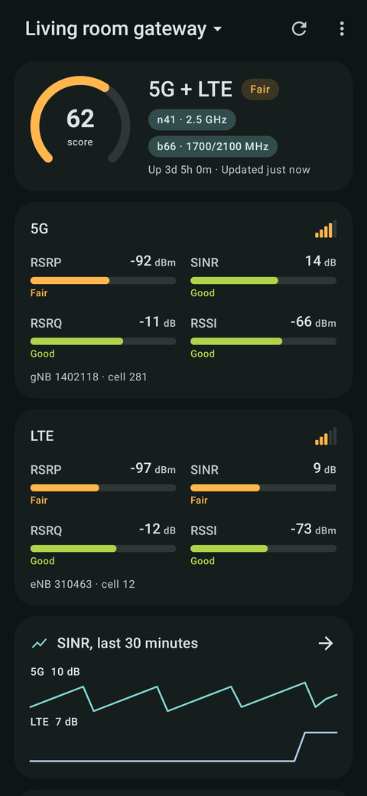
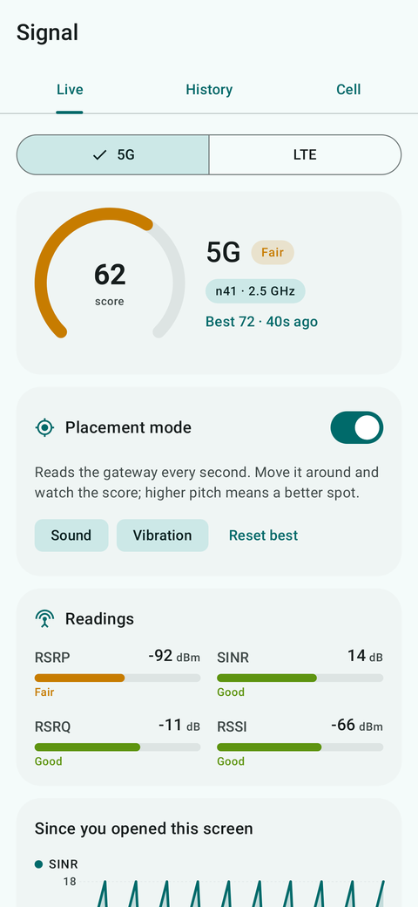
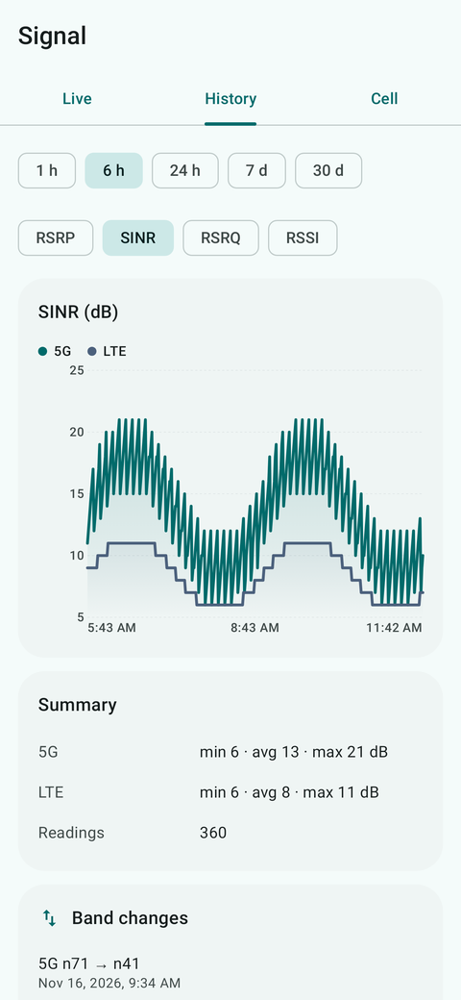
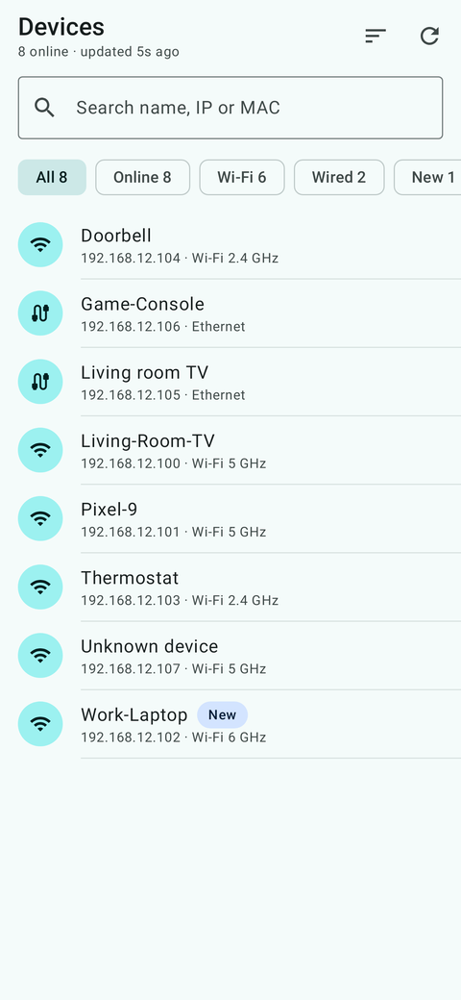
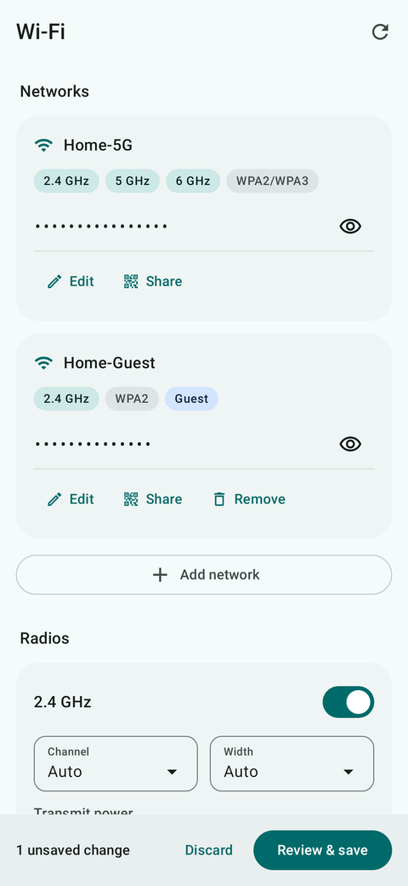

# Hint Plus

**View and control your T-Mobile Home Internet gateway from Android.** Signal, connected devices, Wi-Fi settings, reboots and more in one app, with a built-in demo so you can look around without a gateway.

Hint Plus is an Android-only rewrite of **[HINT Control](https://github.com/zacharee/HINTControl) by Zachary Wander ([@zacharee](https://github.com/zacharee))**, used under the MIT License. The way Hint Plus talks to gateways (the API calls, data formats and many of the safety warnings) comes from his work. Please support the original project.

Hint Plus is not made by, endorsed by or affiliated with T-Mobile.

<p>
  
  
  
  
  
</p>

*Screenshots use the built-in demo gateway.*

## Download

Get the latest APK from **[Releases](https://github.com/The412Banner/HINTControl/releases/latest)**. Android 8.0 or newer.

After that, the app updates itself: it checks this repository's releases, shows what's new, downloads the APK, verifies its SHA-256 checksum and hands it to Android's installer.

## Supported gateways

| Gateway | Connection | Tested on real hardware |
| --- | --- | --- |
| Arcadyan TMO-G5AR | TMI API (port 8080) | ✓ Firmware 1.00.06: detection, login, status, 5G signal, connected devices |
| Arcadyan KVD21, TMO-G4AR | TMI API | Not yet |
| Sagemcom FAST 5688W | TMI API | Not yet |
| Sercomm TMO-G4SE, TMO-G5SE | TMI API | Not yet |
| Nokia 5G21 | Web interface (CGI) | Not yet |

Support for these models comes from HINT Control and is covered by automated tests against recorded gateway responses. If you try Hint Plus on a model marked "Not yet", please [open an issue](https://github.com/The412Banner/HINTControl/issues) and say what works.

Like any app of this kind, Hint Plus reaches the gateway only while your phone is on the gateway's own network (Wi-Fi or Ethernet). T-Mobile gateways can't be reached from the internet.

## What Hint Plus adds

Compared with HINT Control:

- **Signal score and ratings**: a 0–100 score, Excellent-to-Poor ratings for RSRP, SINR, RSRQ and RSSI, and bands shown with their frequency (for example `n41 · 2.5 GHz`)
- **Placement mode**: one reading per second, with a tone and vibration that rise as the signal improves, and the best spot remembered
- **More from signal history**: band changes marked on the chart and listed, an optional fixed chart scale, and CSV export
- **Cell details**: the eNB and sector worked out from the LTE cell ID when the gateway doesn't report them, and your own names for cell towers
- **Device names**: give devices your own names, see when they first appeared, and spot new devices and private (randomised) MAC addresses
- **Review before saving**: every Wi-Fi change is listed for you to check before it's sent, on top of HINT Control's warnings, and afterwards Hint Plus checks which changes the gateway actually kept
- **Share Wi-Fi as a QR code**
- **Speed test**: download, upload, ping and jitter (using Cloudflare's speed test servers), saved with your gateway's signal at the time so you can compare spots and bands; plus a shortcut to Speedtest by Ookla
- **Scheduled reboots** on chosen days and times
- **Alerts**: notifications when the gateway goes offline (only while you're on its network), restarts, has a weak signal, gets a firmware update or a new device joins, plus an event log
- **Quick Settings tile and app shortcuts**
- **Several gateways**, each with its own saved login
- **Demo gateway** that shows every screen without hardware

## What's different

- **Android only.** HINT Control runs on Android, iOS and desktop. Hint Plus focuses on Android and is built with Jetpack Compose and Material 3, with layouts for phones, tablets and landscape handhelds.
- **Privacy.** Your gateway password is encrypted with the Android Keystore, and there's no third-party crash reporting; crash details stay on your phone until you choose to share them. See [PRIVACY.md](PRIVACY.md).
- **Updates.** Updates come from this repository. Each download is checked against its published SHA-256 file, and test builds (pre-releases) can be turned on or off.
- **Automation.** Instead of a Tasker plugin, Hint Plus accepts simple broadcasts that work with Tasker, MacroDroid and similar apps (the Tasker plugin library is GPL-licensed, which doesn't fit this MIT app).
- **Separate app.** Hint Plus has its own package name (`com.banner.hintcontrol`), so it can be installed next to HINT Control.

## Fixed compared with HINT Control 1.17.3

- **G5AR / G5SE: Wi-Fi devices didn't show.** These gateways list Wi-Fi clients in one `wifi` group, which wasn't read, so only wired devices appeared. Found by [cmarker84](https://github.com/cmarker84) and confirmed on a G5SE by [fitzmorrispr](https://github.com/fitzmorrispr) in [HINT Control issue #123](https://github.com/zacharee/HINTControl/issues/123).
- Changing the 6 GHz channel or width overwrote the 5 GHz settings.
- Nokia 5G21: the SIM always showed as inactive, and login used saved credentials instead of the ones you typed.
- The gateway's reported location was never read.
- The gateway password was stored unencrypted.
- Gateways that answer slowly showed as "not found" ([#122](https://github.com/zacharee/HINTControl/issues/122)); Hint Plus now waits longer before giving up.
- "Can't reach the gateway" now says when a VPN is on ([#84](https://github.com/zacharee/HINTControl/issues/84)), and a refused correct password explains the gateway restart fix ([#2](https://github.com/zacharee/HINTControl/issues/2), [#129](https://github.com/zacharee/HINTControl/issues/129)).

## Permissions

| Permission | Why |
| --- | --- |
| Internet, network state | Talk to the gateway; check for app updates on GitHub; run speed tests |
| Wi-Fi state | Show the phone's Wi-Fi link speed next to speed test results |
| Notifications | Alerts and update notices (you're asked once) |
| Exact alarms, start at boot, foreground service | Scheduled reboots at the time you set, also after the phone restarts |
| Install apps | Install updates you choose to download (Android asks you to allow this the first time) |
| Vibration | Placement mode feedback |

## Automation

Turn on **More → Automation**, then send a broadcast from Tasker, MacroDroid or another automation app:

| | |
| --- | --- |
| Action | `com.banner.hintcontrol.action.REBOOT` or `com.banner.hintcontrol.action.REFRESH` |
| Package | `com.banner.hintcontrol` |
| Extra | `token`: the token shown in the app |

## Building

GitHub Actions builds every push to `feat/**` and `fix/**` branches ([build.yml](.github/workflows/build.yml)): unit tests, the release APK, signing with the public AOSP test key (v1 + v2 + v3) and screenshots of every screen with demo data.

To build locally you need JDK 17+ and the Android SDK:

```
./gradlew :app:assembleRelease
```

The gateway module is plain Kotlin and builds without the Android SDK:

```
./gradlew -PgatewayOnly=true :gateway:test
```

| Folder | Contents |
| --- | --- |
| `gateway/` | Gateway clients (TMI and Nokia), demo gateway, auto-detection, signal ratings, tests |
| `app/` | Android app: Compose UI, signal history (Room), settings (DataStore), background jobs, widget, tile, updater |

## Credits

- **[HINT Control](https://github.com/zacharee/HINTControl)** by Zachary Wander: MIT License. Gateway API flow, data models and safety warnings.
- **cmarker84** and **fitzmorrispr**: the G5AR/G5SE Wi-Fi client findings ([issue #123](https://github.com/zacharee/HINTControl/issues/123)).
- AndroidX and Jetpack Compose, Kotlin, OkHttp, ZXing: Apache License 2.0.

## License

MIT, see [LICENSE](LICENSE).
Copyright (c) 2023 Zachary Wander. Android rewrite copyright (c) 2026 The412Banner.
